  

  <a href="https://www.linkedin.com/in/abraham-nigussie-558579245/">
    LinkedIn ↗
  </a>
  &nbsp;&nbsp; / &nbsp;&nbsp;
  <a href="mailto:nigussieabreham80@gmail.com">
    Get in touch ↗
  </a>

 

<h3>I work where the pieces need to come together.</h3>

  Interfaces, services, infrastructure—and the decisions between them.
  I’m a full-stack engineer with 5+ years of experience turning
  product requirements into working software.

  I’ve built platforms that adapt to different businesses, booking
  experiences across multiple services, and systems that communicate
  in real time. I’ve also worked on the less visible parts:
  shared architecture, reusable code, and understanding what
  happens in production.

  What keeps the work interesting is the judgment it takes:
  when to build, when to simplify, and what needs to hold up
  when the requirements change.

 

  
<strong>How I think about engineering ↗</strong>

   

  <table>
    <tr>
      <td width="50%" valign="top">
        <h3>Understand the problem</h3>
        

          Ask the right questions before choosing the tools.
        

      </td>
      <td width="50%" valign="top">
        <h3>Keep it simple</h3>
        

          Build what’s needed. Question what adds unnecessary complexity.
        

      </td>
    </tr>
    <tr>
      <td width="50%" valign="top">
        <h3>Make change easier</h3>
        

          Leave clear intent and code the next engineer can work with.
        

      </td>
      <td width="50%" valign="top">
        <h3>Own the result</h3>
        

          Shipping includes understanding what happens after release.
        

      </td>
    </tr>
  </table>

 

  
    <a href="mailto:nigussieabreham80@gmail.com">
      LET’S BUILD SOMETHING USEFUL ↗
    </a>
  

